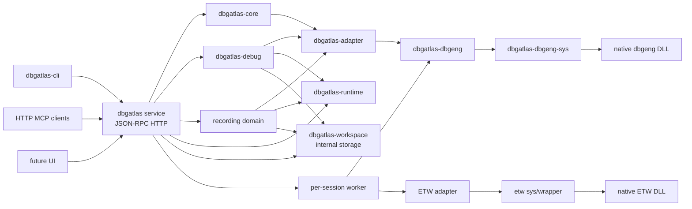

# DbgAtlas 架构

DbgAtlas 是面向 AI 的调试平台，以原生调试命令为主要操作入口，先完善 Windows 调试与录制。远端后端、SQLite 历史、Linux 和管理页面按 `GOALS.md` 逐步实现，当前文档中的本机 service/worker 结构仍是现有实现。源码仓库产出工具本身，不承载真实分析数据；真实分析数据放在显式 analysis workspace 中。

## 分层

`dbgatlas service` 是产品运行时控制面。CLI、HTTP MCP 和后续 UI 都是 service client，不是架构核心。对外 API 使用 JSON-RPC 2.0 over loopback HTTP，默认要求 bearer token；`/rpc` 承载 DbgAtlas 自有 JSON-RPC API，`/mcp` 承载 MCP JSON-RPC HTTP endpoint。长操作可以通过 HTTP streaming/SSE 返回 progress/output，但取消必须显式请求，断线不等于取消。

对外 API 不暴露 `workspace.*`、`project.*` 或 `worker.*` 业务资源。调用方在创建 session 时传入 `project_root`；service 内部把它解析为 `<project_root>/dbgatlas` 作为 analysis workspace，并懒创建该目录。`workspace` 仍是内部持久化模型，负责 manifest、artifact metadata、operation log 和受控 artifact path。

service `0.3` 使用统一方法注册表定义 canonical method、domain route、MCP 描述、输入 schema 和 capability gate。JSON-RPC dispatch 与 MCP `tools/list` / `tools/call` 共享该注册表，避免入口能力漂移。项目事实通过 `artifact.list`、`operation.list` 和 `audit.list_commands` 暴露，三者都接收 `project_root`，不向调用方暴露内部 workspace 路径。

`session` 是公开生命周期对象，`worker` 是内部运行时对象。当前默认一个 session 绑定一个 worker；创建 session 时创建 worker，关闭或 kill session 时结束对应 worker。worker 由 service 的 lifetime pipe heartbeat 和 worker 侧 watchdog 管理，service 正常退出时主动关闭 worker，异常断开时 worker 应自主退出。

`dbgatlas-debug` 代表 debug domain manager 边界：它定义 target、session、command 和状态模型。DbgEng、TTD、dump eval 等能力由 domain manager 编排 runtime、workspace 和具体 adapter/native wrapper。

`recording` 代表事件录制 domain 边界。Recording 以 ETW API 为主线，公开 `recording.*` lifecycle，内部通过受控 worker 和 C++ ETW adapter 采集、过滤并归档低层事件材料。recording 独立于 debug session；调试和外部分析 workflow 可以引用 recording artifact。

`dbgatlas-runtime` 代表运行时安装与进程策略边界：调试/录制工具发现、symbol path、proxy、child process policy 属于 runtime config，不写入 analysis workspace manifest。

## 工程基础边界

- `dbgatlas-model` 只放最小公共模型：`Id`、`WorkspaceRef`、`TargetRef`、`SessionRef`、`ArtifactRef`、`OperationRef`、`Timestamp`。
- `dbgatlas-workspace` 只管理磁盘事实：manifest、`artifacts/`、`analysis/`、可选 `inputs/`、artifact metadata、operation log。
- `dbgatlas-adapter` 只定义最小 adapter contract：adapter id、capability、invocation、result、error。
- `dbgatlas-core` 编排 workspace 与 adapter，不直接接触 unsafe FFI。
- `dbgatlas-cli` 提供本地开发、运维和 workflow 调用入口。
- `*-sys` crate 和 safe wrapper 负责把 native ABI 暴露为 Rust 侧能力，core 不直接接触 unsafe FFI。

## 架构加固边界

- `dbgatlas-debug` 定义 debug target、session state、session skeleton、command eval 请求/结果和 manager trait；它不是 DbgEng wrapper。
- `dbgatlas-runtime` 定义 runtime config、tool path、symbol path、proxy 和 process launch policy；它不拥有 workspace 数据。
- `dbgatlas-workspace` 增加受控 artifact layout helper，例如 `artifacts/sessions/<session_id>/`、`artifacts/recordings/<recording_id>/`、`artifacts/profiles/<profile_id>/`、`artifacts/ttd_recordings/<recording_id>/`。Recording 使用统一的 `artifacts/recordings/<recording_id>/` namespace；旧的 profiles/ttd_recordings 预留布局仅作为兼容背景保留。
- `dbgatlas-core` 保持短调用 `invoke()`，并预留长任务 operation 状态：`running`、`success`、`failed`、`canceled`。
- 同一 debug session 的请求必须串行化；不同 session 后续可并发。状态不能依赖命令文本解析。
- `dbgatlas-adapter` 不是 session/backend 总接口；session 生命周期、worker 管理和 domain 语义由 domain manager 承担。

## Service 边界

- 同一个 `dbgatlas.exe` 提供 `service run` 开发模式、安装态 Windows service 入口和普通 CLI client 命令。
- Windows service lifecycle 由 `dbgatlas service install/start/stop/status/uninstall` 管理。默认安装根是 `%ProgramFiles%\DbgAtlas`；安装器和提权脚本应复用 service 命令默认行为，只有自定义目录时才显式传入 `--install-root`。`install` 支持复制 payload 到 `<install-root>\bin`，也支持 `--payload-mode use-existing` 直接使用安装器已放置的 `bin`；配置/token 放在 `<install-root>\etc\`，服务日志放在 `<install-root>\var\log\`，DbgAtlas 受控 WinDbg runtime 放在 `<install-root>\bin\rt\`。SCM 只指向安装目录下的 binary，避免锁住开发构建产物。
- 安装态 service 可通过 `service.update` JSON-RPC/MCP 方法从构建好的 payload 目录异步更新自身；更新由独立 updater 进程完成 stop、rename swap、restart 和 best-effort cleanup。
- `debug.session.create` 接收 `project_root` 和 target，返回 `session_id`；后续 `debug.eval`、`debug.modules`、`debug.threads`、`debug.stack`、`debug.session.close` 和 `debug.session.kill` 只需要 `session_id`。
- 外部 service API 表达产品能力；内部 worker protocol 表达低层执行、状态、artifact 写入清单和进程控制。两者分层演进。
- Worker identity 按 capability policy 选择：安装态 debug 默认 LocalSystem，可在 `debug.session.create` 请求中用 `worker_identity: "active_interactive_user"` 显式切到交互用户；ETW recording 默认 LocalSystem 或显式配置的受控 identity。权限不足时返回结构化错误，不自动提权。

## 预留但不创建

第一版不创建 `dbgatlas-dia*`、`dbgatlas-symbol`、`dbgatlas-pe`、`dbgatlas-report`。这些能力在 core/workspace/adapter API 稳定后再引入。

service-hosted HTTP MCP 入口通过现有 service/domain workflow 暴露 MCP tools，不复制 debug/session/recording 业务逻辑，也不提供独立 stdio MCP 进程。

IDA 静态分析由外部工具负责。调试符号、类型、局部反汇编和地址信息仍由调试后端提供。

ETW recording 路线优先走 C++ adapter + Rust safe wrapper：ETW session、provider enable、实时消费、预处理和过滤留在 native adapter 内部，Rust 侧负责安全封装、worker 编排、artifact 登记和 service/CLI/MCP 入口。WPR/WPAExport 不作为主采集链路。

## 不做的事

- 不使用隐藏 `.dbgatlas`。
- 不建立中心化 `protocol` crate。
- 不提前设计完整 GUI。
- 不提前封装完整 DbgEng。
- 不引入复杂序列化框架。
