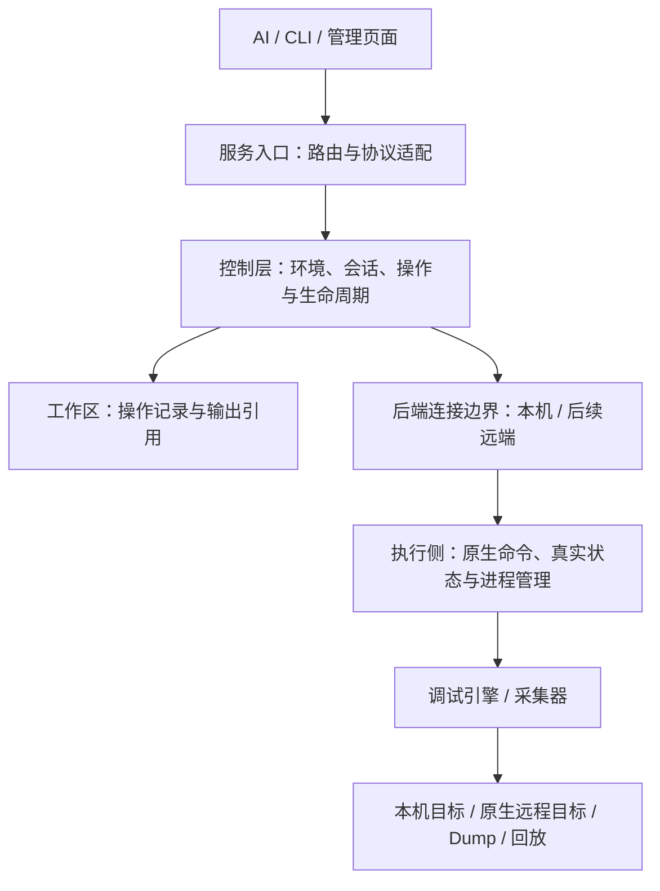

# DbgAtlas 架构规格

DbgAtlas 面向 AI 提供原生调试命令执行、会话管理、状态查询和操作历史。Windows 为首个实现平台，后端可逐步部署到其他机器和操作系统。IDA 静态分析由外部工具承担；调试需要的符号、类型、局部反汇编和地址信息仍在范围内。

## 文档分工与实现状态

- 本文定义总体职责和依赖方向；[环境与会话模型](environment-session-model.md)定义环境、目标、会话及状态语义。
- [后端执行边界](adapter-model.md)定义原生执行与后端契约；[进程与生命周期](worker-model.md)定义进程所有权和故障处理。
- [原生执行与可靠交互](execution-interaction.md)细化迭代 3 的接口、执行侧改造和验收方案；[3A 原型验证](iteration-3a-validation.md)已收敛机制与协议，[3B 执行侧实现](iteration-3b-validation.md)、[3C 公共接口与有限等待](iteration-3c-validation.md)、[3D MCP/CLI 收敛](iteration-3d-validation.md)已完成本机验证；代表性安装态验收已于 2026-11-16 补齐，完整范围见[迭代 3 验证记录](iteration-3-validation.md)。
- [运行时模型](runtime-model.md)、[工作区模型](workspace-model.md)、[录制模型](recording-model.md)分别维护部署、持久化和采集规格。
- [PLAN.md](../PLAN.md)只负责实施顺序、验收和进度；[当前实现基线](roadmap.md)描述已存在的代码路径。验证记录是对应提交的历史证据，不是后续功能的验收证明。

以下目标架构尚未全部实现。迭代 2 的重点是环境、会话和进程架构，迭代 3 才收敛 AI 执行交互，迭代 6 才实现远端传输。不要把目标图中的连线当成当前可调用能力。

## 目标职责分层

控制层负责选择执行环境、建立会话绑定、分配操作身份、管理输出和生命周期。执行侧负责本环境的引擎加载、进程身份、原生命令执行和状态回报。连接边界不决定调试命令语义，也不把传输断线解释为目标退出。

逻辑分层不要求每层成为独立进程或 crate。迭代 2 依据实际依赖决定代码归属，不为图中每个方框创建服务或模块。

## 三个位置与两种远程

控制端位置、后端进程所在环境、目标所在环境分别表达。本机是默认执行环境，不是所有路径和 PID 的全局解释空间。

- 远端后端：控制端连接另一环境中的调试器进程。
- 原生远程目标：调试器通过其原生调试协议连接另一个环境中的目标。
- 两者可组合；离线 Dump/回放在后端环境中打开，产生记录的原环境只作为来源信息保存。

环境是执行和定位上下文，不等于虚拟机，也不要求客体安装 Agent。虚拟机启停、快照和实验编排不属于迭代 2；普通客体执行通道也不是内核调试连接的前提。

## 面向 AI 的操作面

原生命令执行是主要入口，补充会话发现/建立、状态、中断、关闭和历史读取。不要把 WinDbg/GDB 的全部命令重新设计成统一 JSON 工具，也不要因采用原生命令而放弃可靠的状态与事件获取。

平台统一执行外层信息：execution_id、会话与目标上下文、完成情况、结果预览和完整输出引用。原生输出及平台特有字段保留；不同后端的命令、异常/信号和能力无需强行同构。迭代 3 采用 session.* 和 execution.* 命名，具体契约见[执行交互方案](execution-interaction.md)；RPC、MCP 与 CLI 已复用这些接口、有限等待及有界输出读取。MCP 默认发现面隐藏旧 debug/operation 别名，兼容调用仍进入同一执行协调器。

命令知识与调试方法按需提供。平台不把高层分析结论作为工具事实，也不建立独立的 Observation 业务资源；Execution 承载一次动作的输入和输出，会话承载无直接请求来源的事件。execution.cancel 请求取消指定执行，session.interrupt 请求中断当前目标运行，两者不能互换。

## 会话、历史与存储

目标模型统一采用 Session + Execution：Session 保存持续的执行现场，Execution 保存一次已接受动作从开始到结果留存的事实；动作种类用 action 表达。当前 3C 公共接口投影为 Execution；内部 Operation/OperationDetails、旧 operation.* 别名与 operations.jsonl 保留兼容，不改写历史事实。

会话在工作区内固定绑定一个专用工作进程，承载调试或录制生命周期，包含环境、后端、目标、执行身份和处置策略。会话不是 worker PID，也不拥有目标全部历史。不同会话可以引用同一份离线记录，但当前线程、栈帧、回放位置和符号设置独立。Execution 的结果引用不依赖来源会话仍然活动。

Artifact 是 Session/Execution 引用的材料：工具产物记录 producer_session_id，可确认时补充 producer_execution_id；外部输入无虚构 producer。身份与文件由 workspace 保管，后续会话可以引用同一材料，关闭会话不删除或改变其来源。该关系不要求物理汇聚多会话产物或引入第三个业务控制中心。

历史归入显式 analysis workspace。当前使用 JSONL 和产物文件；迭代 4 与迭代 5 管理页面并行，M1 已通过独立本机管理端口展示真实记录，后续引入 SQLite 保存结构化记录、完整输出继续留在文件；迭代 7 完善稳定目标身份与跨会话检索。迭代 2 只建立关联位置和运行实例边界，不提前实现内容寻址、SQLite 表结构或自动结果缓存。

工作区逻辑输出引用与执行侧文件位置分开。本机可由边界内的实现直接写受控目录；未来远端产物需要明确取回或远端引用状态，不能把远端绝对路径当成本机可读路径。

## 当前代码与目标职责的关系

| 当前代码 | 已有职责 | 迭代 2 调整方向 |
| --- | --- | --- |
| `dbgatlas-service` / `ServiceHost` | HTTP/MCP 路由、会话、worker、录制及工作区编排 | 分清入口、控制与执行依赖，不能只给现有 supervisor 换名 |
| `dbgatlas-model` | 公共 Session、OperationDetails、环境/进程身份与状态 | 与本机运行对象分开 |
| `dbgatlas-debug` | 目标、会话、命令及 manager 类型 | 引入环境/后端关联和生命周期边界，避免公共模型绑定本机 worker |
| `dbgatlas-core` / `dbgatlas-adapter` | 通用短调用与产物登记 | 不是现有所有调试调用的必经路径；同步 invoke 不等于完整后端协议 |
| `dbgatlas-worker-protocol` | DbgEng/ETW/TTD 专用 worker 的 v9 JSONL 消息 | 是既有实现协议，含本机路径；不直接宣称可用于远端执行 |
| `dbgatlas-runtime` | 工具发现、安装和本机身份策略 | 将执行侧配置归属到对应环境，不在控制层解释远端安装路径 |
| `dbgatlas-workspace` | 工作区、操作与产物记录 | 保留当前落盘路径，逐步接收与执行位置解耦的输出关联 |
| native adapter / safe wrapper | DbgEng、ETW 本地能力 | 留在执行侧，FFI 不成为跨机器协议 |

CLI、MCP 和管理页面必须复用平台业务实现。这里的控制层是职责，不表示当前代码已经全部搬入名为 `dbgatlas-core` 的 crate。

## 实施边界

1. 迭代 2 建立环境/会话模型与进程执行边界，本机路径完整运行。允许为表达新模型作最小必要 API/schema 调整，不要求保留把 worker 当会话的假设。
2. 迭代 3 明确命令等待、中断和长操作交互；不得将现有超时杀 worker 行为描述为目标规格。
3. 迭代 4/7 依次实现历史存储和跨会话关联；历史保留不等于调试器进程可恢复。
4. 迭代 6 实现远端连接、身份与结果核对；环境模型的存在不代表远端已可用。
5. GDB、官方 DbgX MCP 等接入方案按实际能力验证选择，不强制所有后端使用 C++ DLL，不预先替换现有 DbgEng。

当前 `/rpc` 和 `/mcp` 保持无认证的 loopback 服务，并校验浏览器 `Origin`。未来远端后端通道独立设计，不能直接放宽当前 listener 来代替。安装与验证命令见[安装配置](install-configuration.md)及根目录 AGENTS.md。

管理页面通过独立 loopback listener 提供只读查询，默认 `127.0.0.1:7332`；复用服务已知状态与 Workspace 文件记录，不转发通用 RPC。迭代 4/5 的共同 MVP 先使用真实 JSONL，SQLite 元数据迁移与页面完善按共同里程碑推进，完整输出文件保留。范围见[管理页面说明](management-ui.md)。
