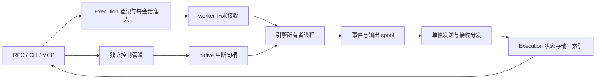

# 原生执行与可靠交互：迭代 3 方案

日期：2026-11-15。实现基线：`d2fb7d1`。状态：3A/3B 已完成本机验证，3C 公共接口与输出读取已实现；验证范围见 [3C 记录](iteration-3c-validation.md)。3D 协议/CLI 收敛与安装态验收仍未完成。

本文以 Session + Execution 细化原生执行、等待、事件、输出和中断的接口契约；实施顺序与验收状态由 [PLAN.md](../PLAN.md)维护。沿用[迭代 2 会话模型](environment-session-model.md)的生命周期与归属规则及[进程所有权规则](worker-model.md)，在本轮统一业务命名，不引入新的后端服务、命令语言或通用任务平台。[3A 验证记录](iteration-3a-validation.md)已固定首版机制和 MCP 选择；默认等待预算仍需产品端测量。

3A 裁决：保留自有 DbgEng adapter；所有者线程持续等待事件，控制走独立通道；有限 wait_ms 只作用于服务等待，不能下传 WaitForEvent。首版 MCP 采用实测的 2025-06-18 普通工具调用与 execution.get/read，不声明 Tasks。官方 WinDbg MCP 状态/中断/断连已对照，命令输出返回失败，未作为替换后端依据。

## 1. 结论与范围

本轮保留 DbgEng native adapter、安全封装和每会话专用 worker，完成两个目标：

1. 调试执行不再依赖一次 HTTP 请求的寿命；命令完成、目标运行、调用等待结束分别表达。
2. 用 `session.*` 接受动作、观察现场，用 `execution.*` 追踪一次执行及读取输出，形成可靠的 AI 交互闭环；MCP 标准长任务只作为 Execution 的协议适配。

默认本机用户态 launch/attach、Dump 和 TTD 回放是验收范围。ETW/TTD 录制保持既有能力并做回归，不在本轮同时重做录制异步 API。SQLite、远端后端、服务重启恢复现场、完整多进程调试、内核完整链路和 UI 仍在后续迭代。

## 2. 3A 开始时的实现与缺口

| 位置 | d2fb7d1 基线实现 | 本轮需要改变 |
| --- | --- | --- |
| [method_registry.rs](../crates/dbgatlas-service/src/method_registry.rs) | `debug.eval`、`eval_steps` 与 modules/threads/stack 等包装入口全部公开；timeout 描述明确会杀 worker | 原生 `session.exec` 成为主入口；减少重复的 MCP 命令包装；显式区分等待与控制 |
| [host_worker_ops.rs](../crates/dbgatlas-service/src/service/host_worker_ops.rs) | `eval_command` 分配操作并记账，但调用方等待 worker 完成才能拿到正常结果；`request_worker_with_optional_timeout` 超时杀 worker | 服务持有执行任务；调用只等待有限时间；响应总能定位已接受操作 |
| [service.rs](../crates/dbgatlas-service/src/service.rs) | `ProcessWorkerSupervisor::request_worker` 持有 transport mutex 直到读完响应；取消拿不到锁就 kill | 请求写入、响应接收、控制通道分别调度；取消不隐式升级为 kill |
| [worker_transport.rs](../crates/dbgatlas-service/src/service/worker_transport.rs) | 一请求一响应，读下一行并要求 request_id 相同；snapshot 只随响应更新 | 单独接收循环按 request_id 分发响应，持续处理事件；迟到响应不能污染下一次请求 |
| [dbgatlas-worker.rs](../crates/dbgatlas-service/src/bin/dbgatlas-worker.rs) | 单循环读请求、执行、取 snapshot、写响应；执行期间不能处理新请求；CancelOperation 只是空闲时 ack | 引擎所有者线程、控制接收路径、输出发送路径分离；真实执行/取消结果取代引擎外推测 |
| [dbgatlas_dbgeng.cpp](../native/adapters/dbgeng/dbgatlas_dbgeng.cpp) | 初始化时 WaitForEvent；命令走 Execute；文件输出 callback 按调用临时安装；launch 的 break callback 随后恢复；没有 SetInterrupt C ABI | 会话级事件/输出回调及事件消费；受生命周期保护的跨线程 interrupt handle |
| [session_model.rs](../crates/dbgatlas-service/src/service/session_model.rs) | `session.get` 获取已有 snapshot 并做进程存活核对；已区分 lifecycle/connection/target_state | 增加引擎执行状态、观察序号、停止原因；不能把缓存包装成实时引擎查询 |
| [host_service.rs](../crates/dbgatlas-service/src/service/host_service.rs) | `operation.get/stream` 返回内存状态/完整 events 数组；stream 不是订阅；initialize 固定 2024-11-05，仅声明 tools | 增加有限等待和游标读取；按版本正确适配 MCP；不把 operation.stream 当作 SSE 或 Tasks |
| [worker_artifacts.rs](../crates/dbgatlas-service/src/service/worker_artifacts.rs)、[model](../crates/dbgatlas-model/src/lib.rs) | 已有完整文件引用、截断标识及 64 KiB 预览；没有公开的按片读取接口 | 复用完整产物，增加服务管理的逻辑输出读取，减少重复回传和模型上下文占用 |
| [host tests](../crates/dbgatlas-service/src/service/tests/host.rs) | 已测试超时杀 worker、取消接受不覆盖成功、批次步骤与产物 | 替换破坏性超时预期，补独立控制、事件消费、等待竞争与真实后端测试 |

上表描述 `d2fb7d1` 方案基线，不代表 3B 完成后的当前行为；当前实现见 [roadmap](roadmap.md)。

已有公共 Session、OperationDetails、环境归属、实例清理、JSONL 更新序号及输出失败分离继续复用。基线中的 `WorkerEvent` 虽有类型定义，尚未接入上述真实响应接收链路，不能据此声称支持实时事件。

## 3. 执行契约

### 3.1 Session + Execution 与 Artifact 关系

Session 是持续的后端执行现场，保存目标、当前上下文、能力和生命周期；Execution 是一次已接受动作的完整执行实例，保存输入、实际执行上下文、状态及输出引用。动作种类用 `action` 表达，如 `session.exec`；输入命令用 `input.command` 表达，不再用 Operation 同时指动作和实例。

- Session 与 Execution 为一对多关系；每个 Execution 固定关联来源 session_id，包括打开、命令、控制及关闭。打开时先建立 opening 会话及其 Execution，再启动后端。查询已有状态、列举与读取输出不另生成 Execution。
- `session.open/exec/interrupt/close/kill` 等动作产生 Execution；`execution.cancel` 的控制请求也留有独立 Execution，以 related_execution_id 关联被取消者。无通用 `execution.create` 接口。
- 同一命令执行两次产生不同 execution_id，即使输入和输出相同。Execution 的查询、输出和历史引用不依赖 Session 仍为 active；本轮服务运行期内保留终态，完整跨重启查询仍在迭代 4 实现。
- Artifact 是 Session/Execution 引用的输入或产物，不作为第三个业务控制中心；不增加 Evidence/Observation 对象或通用产物汇聚服务。

```text
Session
  ├─ Executions
  │    └─ 输出与 Artifact 引用
  ├─ 会话事件与无明确执行归属的异步输出
  └─ 输入 Artifact 引用
```

产物来源与使用关系分别记录：

1. 会话内产生的 Artifact 绑定 `producer_session_id`；可确认具体执行时再填 `producer_execution_id`，且该 Execution 必须属于来源会话。异步会话输出只绑定会话，不强行归给最近一次执行。旧记录无法证明来源时保留 null，不从目录或最近命令猜测。
2. 外部导入的文件登记为输入，producer 字段为 null，来源标为 external；使用它的会话通过输入引用关联，不虚构产出会话。既有非会话短调用产物保留实际来源，也不凭迁移补造会话。
3. Artifact 身份与文件由 analysis workspace 管理。正常或强制关闭会话均不隐含删除产物；保存位置可以继续位于原会话目录，不为名称调整搬迁文件。
4. 后续会话可以引用同一个 Artifact，原 producer 不变，不因新引用复制文件。例如录制会话 A 产生 TTD，回放会话 B/C 分别引用它并保有自己的位置与上下文。
5. 本轮支持同一 workspace 内显式 Artifact 引用与来源留存；`session.open` 的文件目标可按 path 或 artifact_ref 二选一指定，后者解析受控材料并记录输入关联。外部路径沿用现有文件打开行为，不能据路径相同自动认定为同一 Artifact。内容去重、跨 workspace 引用、跨会话自动历史匹配及多来源汇聚后置。

后端能力决定可用动作。`session.exec` 接受原生命令，不把 ETW 录制伪装成命令解释器；unsupported 必须明确返回。`session.open` 的 backend/target 配置使用有区分字段的类型分支，本轮先迁移 DbgEng，已有 recording.* 保留兼容入口和公共会话摘要，不扩大为录制 API 重写。

### 3.2 三个独立事实

- **Execution 状态**：`execution.status` 继续使用 pending / running / success / failed / canceled / unknown。只依据执行侧确认更新；unknown 不自动重放。
- **引擎执行**：新增 `session.engine.state = idle / executing / waiting_for_event / unavailable`，附 run_epoch、observed_at 和来源；会话顶层 active_execution_id 关联当前普通执行。该维度也适用于离线回放，不能把 TTD 回放统一成“始终不忙”。
- **目标状态**：沿用 target_state；在线目标 running/stopped/exited，文件目标保留 offline。回放位置、停止原因与引擎可访问性另行表示，未知字段为 null。

`Execute` 返回与目标停止不是同一个事件。短查询结束可以是 success + stopped；继续命令返回后可以是 success + running，之后的断点/异常/退出由会话事件记录。若后端 Execute 本身仍未返回，则原操作保持 running。不得通过检查命令是否等于 `g`、`p` 等来决定状态。

这里 success 表示后端调用已完成且没有报告执行失败，不保证原生输出中没有命令级错误，也不表示用户的分析目标已经达成。保留原生错误码和输出，不新增靠匹配文本推断“命令成功”的通用解析器。

`session.engine` 表示引擎当前活动，不能与 Execution 资源同名；会话摘要使用 active_execution_id/last_execution_id 引用执行实例，不嵌入另一个含义不同的 execution 状态对象。

### 3.3 等待、取消和中断

| 动作 | 作用对象 | 结束条件 | 不能隐含的行为 |
| --- | --- | --- | --- |
| `wait_ms` 到期 | 本次调用的观察等待 | 返回当时状态与 execution_id | 不取消、不杀 worker、不终止目标 |
| `execution.cancel` | 指定尚未完成的 Execution | 后端接收取消意图，原 Execution 继续单独核对 | 不把 ack 写成原 Execution canceled，不影响下一执行 |
| `session.interrupt` | 当前会话的目标执行/引擎调用 | 返回请求处理结果与最近观察；停止需另行确认 | 不关闭会话，不宣称 target 已 stopped |
| 正常 close | 会话 | 协调执行、detach、输出收尾、worker 退出确认 | 不因等待结束升级到 force |
| 显式 kill | 专用 worker 及已确认归属资源 | 沿用现有异常清理与 cleanup 报告 | 不终止附加目标，不把未知原操作写成成功 |

请求取消已完成操作返回 `already_finished` 及现有结果，不改变原操作。running 操作只有后端确认确实被取消才变为 canceled；若先成功则保留 success，无法确认则保持 running 或在执行侧失联后转 unknown。某些扩展不响应协作中断时返回未确认，调用者仍可显式 kill。

客户端断开仅丢失本次响应/等待，不销毁业务会话。协议取消与业务取消分层：取消一个已经附着到 Execution 的查询等待，停止等待即可；明确的 `execution.cancel` 或标准 task cancel 才进入协作取消路径。各 MCP 版本的断连/取消映射在协议适配层测试，不套用一种处理覆盖全部版本。

本轮不增加默认执行期限；`startup_timeout_ms`、正常关闭收尾期限、TTD 录制时长继续保有各自定义，不能全局改名为 wait_ms。

### 3.4 准入、竞争与断线核对

- 一会话最多一个普通操作，忙时沿用明确 busy 拒绝；不引入用户命令队列。查询、interrupt、cancel 和 force-close 不争用执行占用。
- 引擎正等待运行事件时，第一版拒绝新的普通 exec，返回 `target_running` 和状态；先观察或 interrupt。停止后再查栈/内存，不靠命令白名单允许部分命令插队。离线回放按引擎状态判断。
- 所有接受路径先落盘再派发；执行上下文由引擎线程在真正开始时采样一次，不把排队前缓存当实际执行现场。
- 执行任务由服务持有。HTTP 等待结束不能释放会话占用；占用由执行终结路径释放。执行确认与输出 finalization 分离，归档失败不得覆盖已知执行结果。
- `session.exec` 支持可选 `client_request_id`，使用时必须同时传 `expected_service_instance`，取自创建会话的响应；作用域为 service_instance + session_id。同键同执行输入返回同一操作，同键异输入拒绝；wait_ms 是观察参数，重试时可以调整。仅承诺本服务运行期去重，不能推导跨重启 exactly-once。
- 响应丢失后按同键核对，或从 session 的 active_execution_id/last_execution_id 找回；没有同键时不自动重发有副作用命令。服务运行实例变化必须显式报告，旧键不能在新实例静默重执行。
- 正常完成、cancel、kill、worker 断线通过同一操作终结入口仲裁；已确认结果不被较晚 EOF 覆盖。关闭后迟到事件不能把会话重新置为 active。

## 4. 业务接口

以下 API 已在 3C 的 RPC/普通 MCP 工具入口实现；CLI 专用命令与 MCP 版本/工具列表收敛留在 3D。

| 接口 | 参数/响应重点 | 调整 |
| --- | --- | --- |
| `session.open` | project_root、backend、target、身份/startup_timeout_ms、wait_ms；返回 service_instance、Session、打开 Execution 和 capabilities | 从 debug.session.create 迁移；文件目标支持 path/artifact_ref 二选一；startup_timeout 是初始化期限，等待结束可返回 opening |
| `session.exec` | session_id、command、wait_ms、可选 client_request_id + expected_service_instance；返回 Execution、Session 摘要、预览及输出游标 | 新主入口；一次原生调用，不按换行或分号重新分割 |
| `session.get` | session_id、可选 after_seq + wait_ms；返回状态、active_execution_id、最近停止原因及事件游标 | 无游标时立即返回；带游标可等下一观察变化；不是强制同步刷新引擎 |
| `session.list` | 保留 kind/include_terminal | 用于发现与重连核对，不回传大输出 |
| `session.interrupt` | session_id、可选 expected_run_epoch、wait_ms | 新增独立中断；返回控制 Execution、accepted/unsupported/stale/already_stopped 及观察结果 |
| `execution.get` | execution_id、可选 after_seq + wait_ms | 查询或有限等待；返回输入/状态/结果引用/输出完整性；不默认重复整个 events 数组 |
| `execution.list` | project_root、可选 session_id/status、cursor、limit | 分页列举已登记执行，包含关闭会话的记录；由既有 operation.list 演进，旧记录按已知事实映射，不能把历史 running 当作当前现场 |
| `execution.cancel` | execution_id、wait_ms | 协作取消；分别返回 control_execution 和被取消的 execution；移除 transport 锁忙时杀 worker 的退化行为 |
| `execution.read` | execution_id、cursor、max_bytes | 分片读取这次执行的文本、事件及 Artifact 引用，不要求重复传 session_id |
| `session.read` | session_id、cursor、max_bytes | 读取会话级事件及无明确执行归属的输出；可包含关联 execution_id/Artifact 引用，不重复展开各 Execution 的全文 |
| `session.close` | session_id、wait_ms | 保留正常关闭，先封住新普通执行，再协作中断与收尾；超时返回 closing 和关闭 Execution |
| `session.kill` | session_id | 保留显式强制路径；修正文案，强制结束的会话按现有规则 failed，cleanup 单列 |
| `session.help` | topic，另用 session_id/backend 二选一指定上下文 | 按需返回可用能力、exec/等待/输出用法及少量后端命令指引；不常驻全部命令知识 |

3C 首版 open/exec/interrupt/cancel/close/kill 默认 wait_ms=1000，观察默认 0，上限 30000。wait_ms=0 表示不等待执行结果，不表示不做校验和接受记账。opening 会话只允许观察和关闭协调，普通 exec 明确拒绝；创建响应未拿到 session_id 时不自动重发 launch，先用 session.list 核对。

`execution.read` 与 `session.read` 共用有界读取实现，均返回 items、next_cursor、has_more、complete、gap。默认 8 KiB、最大 64 KiB、最小 4 字节文本预算；额外最多返回 64 个 Artifact 引用，引用不占文本预算，避免小预算永远无法前进。事件当前按来源输出 JSONL 文本片段，由调用者跨页拼接，不承诺一项就是一个完整事件。cursor 是服务生成、绑定读取种类及 execution_id/session_id 的不可解释令牌，不能混用；重复读取同一范围应得到相同内容。无新数据且执行仍运行或会话事件流仍开放时 complete=false，不用空结果冒充 EOF。UTF-8 不在码点中间截断，数字偏移不交由调用方猜测。Execution 已结束但输出收尾尚未完成时仍返回 complete=false；会话流只在收尾结束且无已知缺口时宣告完整。

原生输出与结构化事件有各自来源字段。完整二进制产物继续返回 artifact 引用，不通过该接口塞入 JSON。接口不接受任意本机路径；只读取服务登记的输出，核对工作区归属、文件范围及 Windows junction/reparse 路径，避免逻辑引用绕过受控目录。

输出正常情况下不因内存窗口淘汰丢失：文本先写入受控 spool，引擎事件持久化至 engine-events.jsonl，生命周期事件留在 session-events.jsonl；内存仅保留有界预览与索引。流式读取使用已提交字节边界，完成时原子归档，游标引用不随 .part 重命名失效。I/O 失败显式设置 output_error/gap/complete=false；不保证服务崩溃后恢复执行或所有未提交尾部。

`session.get` 的 after_seq 按状态变化推进，输出读取有独立游标，避免每段日志唤醒状态等待。`execution.get` 的更新序号沿用现有 OperationDetails 的 update_seq 机制；等待只在相关变化、终态或预算结束时醒来。等待不能持有全局 state mutex，多个观察者互不消费对方的事件。

示例：继续执行与等待断点是两次不同观察；示例字段展示精简业务形状，具体序列化应在实现中用契约测试固定。

```json
{"method":"session.exec","params":{"session_id":"session-1","command":"g","wait_ms":1000,"client_request_id":"resume-1","expected_service_instance":"service-1"}}
```

```json
{
  "execution":{"execution_id":"execution-1","session_id":"session-1","action":"session.exec","status":"success"},
  "wait_expired":false,
  "session":{"session_id":"session-1","sequence":12,"target_state":{"state":"running"},"engine":{"state":"waiting_for_event","run_epoch":3}},
  "output":{"preview":"","cursor":null,"complete":true},
  "output_error":null
}
```

```json
{"method":"session.get","params":{"session_id":"session-1","after_seq":12,"wait_ms":10000}}
```

若 Execute 尚未返回，第一个响应的 execution.status 应为 running，后续用 execution.get；命令输出继续用 execution.read。动作响应的 preview 仅供展示；cursor=null 表示从头读取，包括预览已显示的内容。`execution.finalized` 区分任务收尾与后端终态，`output_complete` 还要求没有归档错误或未知结果。`execution.get(wait_ms>0)` 不带 after_seq 时等待收尾，带 after_seq 时等待更新或收尾。上例 complete 只说明该命令输出已结束，之后的目标事件从 session.read 读取。断点命中附 reason、后端事件码、地址/线程与来源；缺少证据的字段保留 null。

## 5. 执行侧与传输改造



### 5.1 DbgEng 与 C ABI

- 在一个所有者线程创建/打开 DbgEng 会话，并在该线程执行普通命令、状态采样、WaitForEvent、detach 和销毁。不要把 DbgEngSession 裸指针简单标为 Send/Sync 后任意跨线程使用。
- 会话级 callback 覆盖命令与空闲运行阶段；记录 breakpoint、exception、目标退出、引擎执行变化及原始输出。回调不反向调用阻塞 RPC，不取得服务全局锁，不递归 WaitForEvent；尊重原生异常过滤器，不把所有事件都强制 BREAK。
- 提供最小 ABI：事件消费/读取、引擎快照、获取/释放独立 interrupt handle、提交 interrupt。事件采用固定结构与 UTF-8 数据视图，批量数据保留 owner/free 规则；不暴露 COM 或 C++ 类型。
- interrupt handle 只支持受允许的控制调用；C++ 内部保有引用及 closing/执行代次校验，Rust 用专用安全类型管理其跨线程生命周期。开始下一命令、完成/关闭和取消投递用短临界区仲裁，锁不得跨越 Execute/WaitForEvent，以免迟到取消命中下一操作。
- `session.interrupt` 使用 SetInterrupt(DEBUG_INTERRUPT_ACTIVE) 请求可控制目标停止；取消活动引擎命令使用 PASSIVE。3A 已确认不配合的扩展不会被强制结束，配合的扩展也可能被外层 Execute 包装为 S_OK；只有可归因的中断证据才结算 canceled。保留原始返回及输出，不能以已接受请求覆盖 success。EXIT 仅作为内部退出等待的机制，不等价于目标中断。
- 引擎运行时由所有者线程持续 WaitForEvent(INFINITE)，不使用短超时轮询：3A 在两版用户态 DbgEng 上均观察到有限等待到期暂停目标。API wait_ms 与引擎等待彻底分离；控制和查询不排在引擎等待后。内部 EXIT 唤醒后的引擎 BREAK 不能当作目标 stopped，需核对事件、目标及处置目的。Dump 不做无意义事件自旋；TTD 回放虽是 offline，仍需消费引擎执行变化。
- attach 配置显式区分 invasive 与 noninvasive；旧 attach 的 noninvasive/no-suspend 行为保持兼容，只声明观察能力。选择 invasive 后才提供目标运行控制，不能通过统一 session.* 命名静默改变目标行为。
- GetInterrupt 会清除用户中断标志，不能在控制线程中以轮询它的方式“观察进度”。仅在执行完成并禁止旧代次投递后，由所有者线程清理残留；ACTIVE 造成的实际目标事件另行消费。代次/完成/关闭竞争仍需 3B 实现测试，不能用 3A 顺序测试替代。
- 对需要额外交互输入的命令，通过 input callback 明确报告 `input_required` 诊断并允许控制请求；本轮不实现通用终端输入接口，也不自动提交空输入。WaitForEvent 的 E_UNEXPECTED 需结合输入请求、事件与目标证据解释，不能一律判为目标退出。
- 同一命令返回后才产生的输出默认归会话；只有可证实的执行关联才附 execution_id。run_epoch 标识一轮继续/停止，不能把所有后续输出都写给最近命令。

微软规定 WaitForEvent 仅能从启动调试会话的线程调用且不可重入，live kernel 的超时必须为 INFINITE；SetInterrupt 可从任意线程调用，但返回只表示注册了请求，ACTIVE 与 EXIT 的效果不同。[WaitForEvent 文档](https://learn.microsoft.com/en-us/windows-hardware/drivers/ddi/dbgeng/nf-dbgeng-idebugcontrol-waitforevent)、[SetInterrupt 文档](https://learn.microsoft.com/en-us/windows-hardware/drivers/ddi/dbgeng/nf-dbgeng-idebugcontrol-setinterrupt)。这些约束支持上面的设计，但不替代本项目后端实测。

### 5.2 Worker protocol 与服务

- 内部协议建议 v7 → v8，保留本机协议边界。增加明确的 accepted/started/completed 消息与带序号的 session event；结果和事件分别标记，不能让旧客户端将事件误解为响应。
- 现有业务管道改为单 writer、单 reader 的全双工消息通道：writer 只在写帧时短暂占锁，reader 长驻按 request_id/execution_id 分发。普通请求仍由会话准入限制为一个。
- 增加独立 control pipe 用于 interrupt/cancel/关闭协调，保持现有 lifetime pipe/watchdog 职责不变。控制通道不发送大输出，也不能排在普通输出写入之后。
- 控制请求含会话、执行代次和关联 execution_id；每次投递核对绑定，旧请求返回 stale。kill 继续由 supervisor 核对进程实例，不依赖卡死引擎响应。
- 服务端执行协调器持有接受、派发、完成与 finalization，不再把工作寿命绑定 handler 栈。接收事件更新 summary 并通知等待者；不为每个轮询请求再启动一个执行线程。
- 输出传输用有界元数据/范围通知，原始大文本保存在文件；状态与控制消息不被大量输出饿死。记录任何不可恢复缺口，并限制线程、内存队列和并发观察者数量。
- close 转 closing 后拒绝新操作；引擎可用后 detach，正常保留目标。重复 close 返回同一个关闭操作；close 与 kill 竞态只结算一次资源，保留真实最终处置与原操作结果。

具体拆分优先在现有 service 模块中增加 execution/control/output 职责文件，在 dbgeng wrapper 内新增必要类型；不引入空泛 Backend 大 trait，不把当前所有路径搬入 Core::invoke。

## 6. MCP 与 AI 工具面

当前实现固定 initialize=2024-11-05、单个 JSON HTTP 响应，仅返回 text content；未实现 Tasks、progress 通知、资源读取或订阅。HTTP 可以并发处理独立连接，但不能据此推断某个 AI 客户端会并发发工具调用。

官方 MCP 2026-07-28 将 Tasks 移入扩展，并改变了版本/能力传递和发现方式；2025-11-25 的实验 Tasks 与新扩展不是同一个 wire contract。因此不能只修改 initialize 的版本字符串或把 execution_id 改叫 taskId。[版本变更](https://modelcontextprotocol.io/specification/2026-07-28/changelog)。

落地策略：

1. 3A 实测 Codex app-server 的 stdio/HTTP 均声明 2025-06-18，未声明 Tasks；首版固定该版本的普通工具调用与 session.exec 有界等待、execution.get/read、session.get/read。保留现有 2024-11-05 客户端所需的兼容响应，按请求版本协商，不把未知版本原样回显。完整客户端工具回合与旧版兼容仍在 3D 验收；以下 Tasks 分支是后续条件，不是首版能力。
2. 标准任务和业务 Execution 使用同一个执行任务与结果存储，taskId 可映射 execution_id，但状态和保留期限不能混为一谈。MCP task 过期不删除工作区事实；业务 unknown 映射协议失败并带明确诊断，不能映射 completed。
3. 若实现 2026-07-28，按该版完整处理 server/discover、每请求版本/能力和结果形状；Tasks 使用扩展的 tasks/get、tasks/update、tasks/cancel。不得向未声明扩展能力的请求返回任务句柄。
4. 只有实际客户端要求旧 Tasks 时才实现 2025-11-25 分支，不一次性维护所有历史版本。旧版与新版取消语义分别适配；不直接照搬新扩展的协作取消到旧协议。
5. 默认工具列表固定、描述简短；核心工具统一为 session.* 和 execution.*，旧 debug.eval、eval_steps、modules/threads/stack/add_symbols 不再作为主要 MCP 命令面。debug.read_memory 保留必要的后端专属二进制产物用途，经同一执行协调器产生 Execution。service/recording/artifact/audit 方法按现有职责保留，不把“精简调试接口”扩成全仓库删工具。
6. `session.help` 按需给出后端指引；优先复用 SDK 可用能力，而非增加调试指令 DSL。支持结构化结果的版本返回一次正文及精简文本摘要，避免完整输出同时复制进 text 和 structuredContent。

新 Tasks 扩展允许协作取消最终仍然完成，并要求请求声明扩展能力；通知也不能证明 AI 已读取结果。[Tasks 规范](https://tasks.extensions.modelcontextprotocol.io/specification/2026-07-28/tasks)。本轮不依赖模型收到后台通知后自动继续，必须能主动查询找回结果。

## 7. 兼容处理与代码归属

公开命名、内部类型和持久化兼容分别推进，不对仓库及旧数据做全局字符串替换。迭代 3 的规范接口映射如下：

| 当前接口/字段 | 迭代 3 规范名称 | 兼容边界 |
| --- | --- | --- |
| debug.session.create | session.open | 旧入口作为 RPC/CLI 薄适配，补 backend=dbgeng，不创建第二份执行记录 |
| debug.eval | session.exec | 同一执行协调器；旧执行超时参数不保留破坏性语义 |
| debug.session.close / debug.session.kill | session.close / session.kill | 同一生命周期和清理实现 |
| operation.get / operation.cancel / operation.list | execution.get / execution.cancel / execution.list | 旧 ID 与新 execution_id 指同一实例，适配层映射旧字段；不双写两个业务实体 |
| operation.stream | execution.read | 过渡入口支持有界读取，旧返回形状变化随 API 版本明确说明 |
| operation_id / related_operation_id | execution_id / related_execution_id | 保留标识值及历史引用；旧记录读取时投影，不批量改写原始 JSONL |
| last_operation_id | last_execution_id | 公共摘要映射；新增 active_execution_id 与 session.engine，不复用旧 Ready/Error 作为引擎状态 |

- 3C 对外 API/包版本已升至 0.4.0；worker v9 防止旧 worker 静默忽略 invasive attach 配置，DbgEng ABI 为 0.7.0。三者与 MCP 版本分开。
- `debug.eval` 作为过渡 RPC/CLI 别名委托新执行路径，默认 MCP 列表裁剪在 3D；3C 已移除超时杀 worker 路径。旧 `timeout_ms` 显式拒绝并指引 wait_ms，不静默赋予相反语义。CLI 参数、错误响应和帮助同步修改。
- `debug.eval_steps` 保留为兼容入口，批次及各步均记录为 Execution，步骤关联 parent_execution_id；复用新执行协调器，不新增另一套核心批处理命名。每步确认为结束且引擎可接受普通命令后才继续；遇到目标运行、unknown、取消或关闭停止后续步骤并返回未执行索引，不隐含等待未来断点后自动执行剩余命令。continue_on_error 只适用于已知失败且会话仍可用。
- modules/threads/stack/add_symbols 等兼容入口委托同一准入/执行实现，不能绕过事件、输出及协作取消；二进制 read_memory 保留受控输出能力。
- operation.stream 作为过渡读取入口委托 execution.read，更新描述；不继续无界回传整个数组。session.read 承载独立会话事件，不把旧 operation.stream 的返回误当会话完整历史。流式游标和 execution.get/read 的跨服务重启恢复仍由迭代 4 实现；execution.list 延续已有持久化列表读取能力。
- 公共模型统一为 Execution，复用现有 OperationDetails 的事实字段和 update_seq 机制；旧 Operation* 类型及 capability 等字段通过明确适配逐步迁移，不能误把已有 ExecutionContext（上下文快照）当执行实例。新 Execution 的动作字段为 action，输入与输出分开；schema_version 和缺省读取规则同步维护。
- 旧 operations.jsonl 文件名、标识值、Artifact 引用和原始记录保留可读，不因命名调整移动文件或改写历史验收记录。旧 capability 可映射到已知 action，无法映射时保留原值及来源；缺失的会话或产物归属为未知，不补造事实。API 兼容层对 recording.* 返回的旧 operation 引用也指向同一 Execution，录制流程本身不重写。

| 代码范围 | 主要改动 |
| --- | --- |
| native/include、native/adapters/dbgeng | 会话回调、引擎事件消费、中断句柄、关闭竞争 |
| dbgatlas-dbgeng-sys / dbgatlas-dbgeng | 局部 C ABI 镜像、安全封装与线程约束 |
| dbgatlas-worker-protocol / worker binary | v9 消息、引擎线程、控制 pipe、事件输出 |
| dbgatlas-service | 执行协调器、transport 分发、等待与终结仲裁、输出读取、MCP 适配 |
| dbgatlas-model / dbgatlas-debug | Session/Execution 契约、session.engine、规范 ID 与旧类型/字段投影 |
| dbgatlas-workspace | 现有 JSONL/文件的事件与输出索引、Artifact producer 和输入引用；不加入 SQLite |
| dbgatlas-cli / tests | exec/interrupt/观察/输出命令、参数迁移、契约和真实后端验证 |

## 8. 实施顺序与退出条件

### 3A：原型与协议选择（路线已收敛）

实测结果见 [3A 验证记录](iteration-3a-validation.md)：23 组独立原型检查通过，TTD 自建短录制/回放通过；实际 Codex 握手与官方 MCP 对照完成。官方命令输出失败、Claude Code 不可用及真实 AI 并发/断线未覆盖如实记录，首版不依赖这些能力。

- 用 MSVC 在 temp/iteration3-probe/ 建立可控目标，测试当前 DbgEng 的短查询、长查询、g/断点/退出、跨线程 ACTIVE/PASSIVE/EXIT、取消残留和 TTD 回放；记录 API 返回与 callback 时序。
- 参考官方 WinDbg/DbgX MCP，采集实际工具 schema，并比较短命令、继续、状态、中断、关闭和断连。官方资料确认 WinDbg MCP 的入口，但不证明本机版本或隐藏 CLI 参数可用；不得凭文档推断探针已通过。[官方入口](https://learn.microsoft.com/en-us/windows-hardware/drivers/debuggercmds/set-up-windbg-mcp)。
- 采集实际 Codex/Claude Code 客户端的协议与能力；如连接工具不可用，明确记录缺项，以独立协议探针验证服务，不把它称作客户端验收。
- 退出条件：确定命令完成与事件泵的真实时序、中断可行边界、首个支持的 MCP 标准版本和 fallback；修订本草案中的候选项。即使官方 DbgX 更合适，替换后端仍需覆盖所有权和输出契约，不能仅凭 tools/list 决定。

### 3B：独立中断与持续状态（本机验证完成）

- 完成最小 native ABI、worker v8、控制 pipe 与事件分发；先跑通 launch → g → interrupt/断点 → 查询 → detach。
- 覆盖 busy、目标退出、worker 退出、控制投递/关闭竞争；通过后再调整公共等待行为，避免只把同步函数包装为“后台线程”。

3B 已落地 worker v8 的 response/event 区分、snapshot 序号和独立控制 pipe。公开增加 session.interrupt；旧 operation.cancel 已接 PASSIVE，不再因业务锁忙而 kill。引擎状态暂放 session.context.engine，公共 Execution 协调和全面命名迁移留在 3C。旧 noninvasive attach 保持观察语义，明确 target_control=false/target_state=unknown；3C 已为 session.open 增加显式 invasive 参数，默认模式保持 noninvasive。

### 3C：服务持有 Execution 与输出读取

- 落地 session.open/exec、短等待、execution.get/list/cancel/read、session.get/read/close/kill、去重核对与兼容入口；产物登记来源，文件目标支持显式 Artifact 输入引用。
- 退出条件：wait 到期后同一 worker 继续执行且结果可取回；大量输出不挡住 interrupt；客户端断开后可核对；执行成功而归档失败不误导重放。
- 已实现的服务协调、游标语义、兼容边界及实测结果见 [3C 验证记录](iteration-3c-validation.md)。执行上下文由 owner 在线采样；打开执行只有打开时可知的请求/worker 上下文，不伪造尚不存在的线程/栈帧。

### 3D：MCP、CLI 和安装态验收

- 按 3A 固定的协议实现标准任务/兼容路径，收敛工具描述及按需帮助，同步 CLI、文档和 schema。
- 运行受影响的 model/debug/protocol/service/workspace/CLI 窄范围测试及 native MSVC 测试，再做工作区回归。
- 用 `script/build-release-install.ps1 -BuildOnly` 构建完整 MSVC release；通过已连接 DbgAtlas MCP `service.update(source_dir=<当前仓库绝对 target/release>, restart=true)` 更新，随后 service.health 和实际客户端冒烟。不能以手工复制或独立 HTTP 调用冒充已连接 MCP 安装验收。
- 3A 已执行独立 MSVC 原型，尚未构建产品 release 或更新安装态服务；当前未发现本机 DbgAtlas SCM 服务，也无已连接 DbgAtlas MCP 工具。实施到安装验收时重新检查并补齐前置条件，不能把 WinDbg MCP 或协议探针当作 DbgAtlas 安装态验收。

## 9. 验收矩阵

| 场景 | 必须观察到的结果 |
| --- | --- |
| 短命令 | 默认一次调用返回结果，输入/实际上下文/输出引用关联正确 |
| 慢查询、符号加载或扩展 | wait_ms 到期返回 running，worker 不变；稍后拿到同一操作结果 |
| g → 断点 | 命令结果和目标状态分别报告；断点事件与停止原因可读取；停止后查栈成功 |
| g → 目标自然退出 | 来自引擎的退出记录与进程监测一致；会话/worker/目标退出不混为一谈 |
| 长命令期间 interrupt | 独立连接/真实客户端均可发出控制；后端确认停止后同一会话继续可用 |
| cancel 与完成竞争 | 返回 accepted 不覆盖原 success；迟到 cancel 不影响下一命令 |
| TTD 回放 | offline 目标下仍正确表达引擎忙/停、回放命令输出和中断能力 |
| 输出超过预览及多字节 UTF-8 | 游标分片重组等于完整文本，无重复/丢失/截断码点；大输出时控制仍可达 |
| 输出写入/登记失败 | 保留已知执行结果；output_error、gap 和完整性如实呈现 |
| HTTP 断连/响应丢失 | 同键核对得到原操作，不重复执行；业务会话存活 |
| close/kill/服务退出 | 正常关闭保留目标；强制清理只处理确认归属实例；活动操作有真实终态或 unknown |
| 后端卡死/worker 崩溃 | 结果未知可见，清理失败可见；不透明重启，不报告普通取消成功 |
| MCP 标准与 fallback | 标准任务取回/取消、无能力客户端普通返回分别验证；无通知仍可完成工作流 |
| 现有录制回归 | ETW CPU、TTD 录制/回放及异常清理没有被 v8/transport 改造破坏 |
| 新旧命名与历史记录 | 旧 operation_id 与 execution_id 定位同一实例，兼容调用不双写；原 JSONL 和 Artifact 引用仍可读取 |
| 会话关闭后的 Execution | 同一服务运行期内仍可 get/read/list，输出不依赖活动 worker，不被关闭删除 |
| Artifact 来源与共享 | 录制 A 产生的 TTD 被回放 B/C 显式引用，producer 保持 A，各自现场独立；关闭任一会话不删除共享材料 |
| 外部输入与异步输出 | 外部输入无虚构 producer；会话异步产物只在有证据时填 producer_execution_id；历史缺失归属保留未知 |

代表性任务比较改造前后工具描述字节数、实际调用次数、返回文本量、完成率与中断延迟。没有实测 tokenizer 时只报字节/字符，不伪报 token 数。普通短命令以一次调用为目标；长操作的默认等待和预览大小由测量结果调整。

最终验证记录单独新增 iteration-3-validation.md，区分契约测试、真实后端、开发态、release、安装态和客户端实测；任何未覆盖项不得写成已验收。
