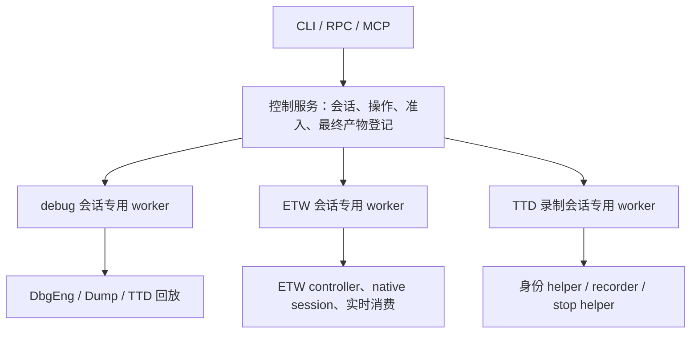

# 专用工作进程与生命周期

本文定义迭代 2 的进程契约；业务资源见[会话与操作模型](environment-session-model.md)，当前验收见[迭代 2 验证记录](iteration-2-validation.md)。

## 执行结构

活动会话与主 worker 一对一固定绑定。辅助进程不成为新的主 worker。一个 worker 退出后不能通过替换进程延续原会话；历史仍可查询。当前三条路径复用既有 worker 二进制及 v8 本机命名管道协议，不新增独立服务。

控制服务保存公共会话摘要和本机运行注册表，负责并发准入、操作记录与工作区最终产物登记。执行侧解析工具路径、持有 native 对象、执行后端动作并返回受控输出声明。公共模型不保存句柄、token 或管道。

## 所有权和处置

| 对象 | 正常关闭 | 异常清理 |
| --- | --- | --- |
| 专用 worker | 完成 detach/录制停止及输出后退出，并确认进程结束 | 结束已登记的确切进程实例 |
| 自启目标 | 保留目标，解除控制并释放异常清理归属 | 允许终止已确认属于本会话创建的实例 |
| 附加目标 | detach 或停止采集，保留目标 | 不主动终止 |
| recorder / helper | 等待完成，回收工具进程 | 结束已确认归属的工具实例 |
| 既有调试器 | 本轮没有接入能力 | 不受管资源不可误杀 |
| 输出与历史 | 保留 | 保留部分输出，明确完整性未知 |

正常关闭失败不能静默降级为终止目标。调用方可以显式强制结束；服务正常退出在限定关闭期限后可以转入异常清理。failed 会话仍可能持有资源，必须允许继续清理。

本机 owned-processes.json 与 helper 子清单分别登记工具/目标进程及创建时间。终止时在同一个已打开句柄上核对创建时间，PID 被复用时不能终止替代实例。正常释放的目标从清单移除。无法确认身份时保留清理未完成的诊断。

DbgEng launch 在所有权登记成功后才提交；未提交的 native launch 析构执行回滚。若启动被中断且无法确认目标身份，unconfirmed-launch.json 保留不确定性，不能报告清理完成或盲目重试。

TTD helper 在控制方登记自身后才允许启动 recorder；recorder 暂停创建、登记后再恢复。helper 的独立 Job 在创建子进程之前建立内核归属，异常退出清理其自建子进程，正常完成先解除 kill-on-close 约束，保留自启目标。PID 日志本身不能证明目标归属；目标登记还需父实例和创建时间证据。

## 创建与关闭

创建：校验/准入 → 会话和打开操作落盘 → 启动候选 worker → 记录实际执行上下文 → 初始化后端/打开目标 → 确认绑定 → 发布活动会话。候选失败需记录原因和清理结果；成功绑定后不再更换。

关闭：停止接受普通操作 → 协调当前执行 → detach 或录制停止 → 整理输出、释放目标归属 → 退出 worker 并确认 → 更新关闭操作和公共摘要。忙时普通关闭可返回明确 busy；服务退出在限定时间内协调并按策略收尾。

客户端 HTTP/MCP 断开不销毁会话。服务与 worker 的 RPC 通道错误、lifetime pipe 断开和 watchdog 是内部进程生命周期事件，不等同于客户端离开。worker 主循环异常退出和 watchdog 都走异常清理，不能依赖线程竞态恰好先触发某条路径。

## 录制资源

ETW 的 controller、native 会话、实时消费和采集产物生成均在专用 worker。采集名称由录制 ID 唯一派生，启动前登记 recovery.json。worker 退出后，执行侧清理 helper 核对名称和输出位置，停止本会话遗留采集；CPU profile interval 仅在仍匹配本会话修改值时恢复。helper 不恢复原会话，也不保证崩溃后的产物完整。

TTD worker 管理 recorder、身份辅助进程、时长停止命令和产物整理。recorder 退出不等于主 worker 已完成归档。强制结束时不得报告完整 trace。TTD 回放仍作为 debug 会话由 DbgEng worker 打开。

CPU sampling 和 TTD 的并发额度由控制服务统一管理，不能因多个 worker 绕过。资源清理未确认时保留额度；ETW 身份保持原服务执行身份语义，TTD 保留现有 recorder 身份选项。

## 交互与后续范围

普通操作使用每会话请求锁并在忙时拒绝，不增加命令队列。状态摘要和强制结束独立于此锁。3B 已将 DbgEng Execute/WaitForEvent 固定在所有者线程；控制 pipe 投递带代次的 ACTIVE/PASSIVE/EXIT，业务 pipe 独立分发 response/event。控制请求不获取业务请求锁，也不自动升级为 kill。MCP 长操作交互与有限等待仍在 3C/3D 收敛。

目标运行时所有者持续 WaitForEvent(INFINITE)。关闭用 EXIT 唤醒；E_PENDING 后不查询线程/栈帧，也不将引擎 BREAK 当成目标停止，随后 detach。异步输出写 session-output.log，缓存事件有界并记录 gap，事件与 HRESULT 分别留在 engine-events.jsonl / engine-results.jsonl；公共游标读取在 3C 实现。

当前 debug 显式执行超时仍可能杀 worker，并使会话失败、原操作结果 unknown；这不是“只停止本次等待”。远端传输在迭代 5 实现；本轮不承诺服务重启恢复现场、worker 池、迁移或真实既有调试器接入。
